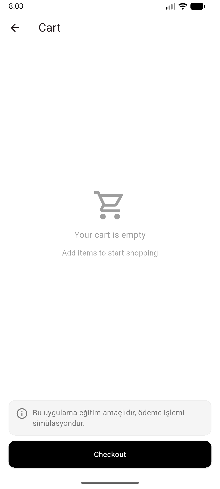

# Mini Katalog Uygulaması

## Kısa Açıklama

Flutter ile geliştirilmiş basit bir ürün katalog uygulamasıdır. Ürünler ana sayfada GridView ile listelenir ve arama kutusu ile filtrelenebilir. Ürüne tıklandığında detay sayfası açılır, "Buy Now" butonu ile ürün sepete eklenir. Sepet sayfasında eklenen ürünler görüntülenir ve sepetten çıkarılabilir. Sepet işlemleri simülasyondur.

Ürün verileri ve banner görseli eğitim amaçlı olarak https://wantapi.com/products.php ve https://wantapi.com/assets/banner.png adreslerinden alınmaktadır. İnternet bağlantısı olmadığında `assets/data/products.json` dosyasındaki veriler kullanılır.

## Kullanılan Flutter Sürümü

Flutter 3.47.7 (Dart 3.13.5)

## Çalıştırma Adımları

```bash
git clone https://github.com/elif-tasdelen/mini-katalog.git
cd mini-katalog
flutter pub get
flutter run
```

## Ekran Görüntüleri

| Ana Sayfa | Ürün Detay | Sepet | Boş Sepet |
|---|---|---|---|
|  |  |  |  |
